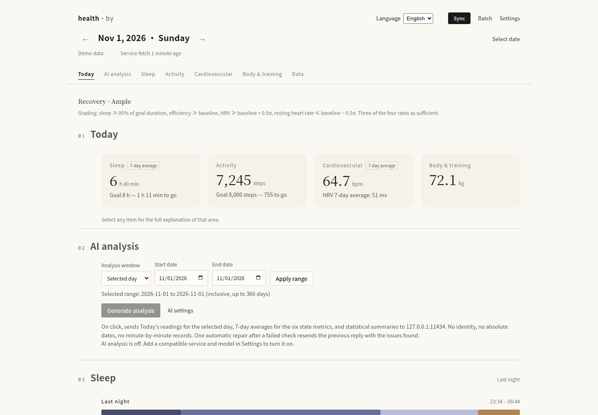
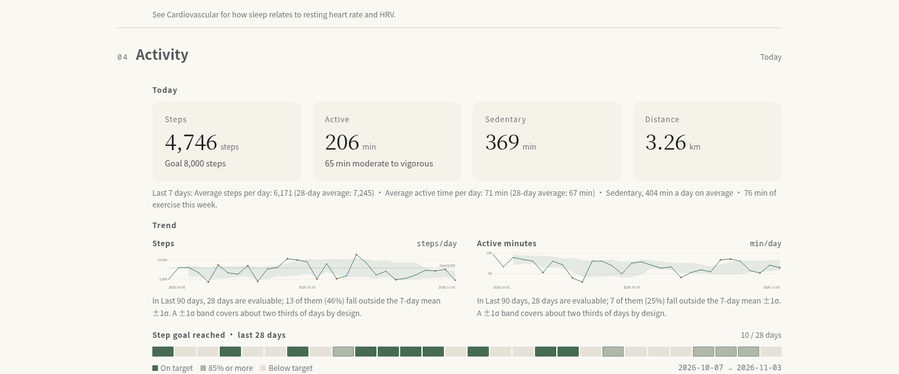
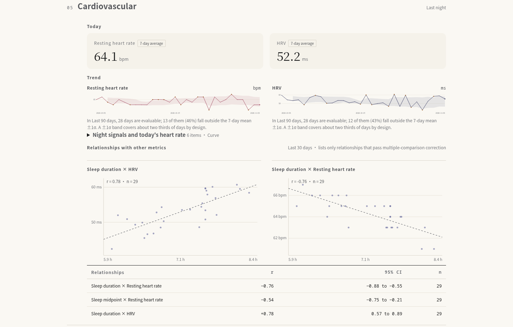
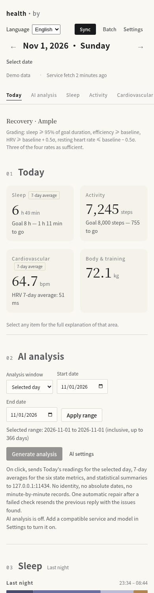

# health·by

**A self-hosted dashboard for your own health data.** Sync from Google Health / Fitbit to your own
machine, keep it long-term, and read it through statistics you can check yourself. No black-box
health score or diagnosis. AI analysis is optional.

- Demo mode works out of the box — no account, no credentials.
- For real data, use your own Google Cloud project (BYO OAuth). Credentials and data stay local.

> Status: `v0.0.1` — MVP plus a layered analysis dashboard. APIs and pages are still moving; feedback welcome.



<sub>Screenshots come from demo mode (a synthetic provider). Numbers are generated, not recorded.
To reproduce: start without credentials and the page shows a "Demo data" badge.</sub>

## What it does

- **Sync** — pulls from Google Health API v4 (Fitbit's official channel); every raw response is archived
  per day, so anything can be recomputed later.
- **Keep it** — a single SQLite file, not just "the last few days".
- **Layered by question** — seven views (Today / AI analysis / Sleep / Activity / Cardiovascular /
  Body & training / Data). Each area page follows the same order: today → last 30 days → patterns → detail.
- **Checkable definitions** — SRI (sleep regularity), social jetlag, 24-hour cosine rhythm, ACWR load
  ratio, SWC, confidence intervals for correlations. Every number's source and formula is in
  [docs/methods.md](docs/methods.md).
- **Rules, not a score** — recovery grades on four fixed thresholds (sleep duration, efficiency, HRV,
  resting heart rate), and the rule is printed on the page.
- **Say what is missing** — coverage, which day is absent, and why a panel is empty are stated
  directly. No placeholder numbers.
- **Optional BYOK analysis** — any OpenAI-compatible endpoint. Generated on demand, cached per model and
  prompt version, with usage and validation issues recorded. See [docs/ai.md](docs/ai.md). Off by default.

## Quick start

### Docker (recommended)

```bash
git clone <repo-url> && cd health-by
docker compose up -d --build
# open http://127.0.0.1:39441 — demo mode is ready
```

It binds to `127.0.0.1` only. For LAN or Tailscale access, change the bind address in
`docker-compose.yml`. **Do not expose the port to the public internet.**

### Run locally

Python 3.11+.

```bash
python -m venv .venv && .venv/bin/pip install -e '.[dev]'
.venv/bin/python -m health_by.cli serve        # 127.0.0.1:39441 by default
.venv/bin/python -m pytest                     # tests
```

## Configuration

All through environment variables; each has a default.

| Variable | Default | Purpose |
|---|---|---|
| `HEALTH_BY_DATA` | `./data` | Data directory (SQLite database + encryption key) |
| `HEALTH_BY_HOST` / `HEALTH_BY_PORT` | `127.0.0.1` / `39441` | Bind address |
| `HEALTH_BY_SYNC_WORKERS` | `2` | Days synced concurrently (shares one outbound rate limiter) |
| `HEALTH_BY_PACE_MS` | `225` | Minimum gap between outbound requests (≈4.4 req/s) |
| `TZ` | `Asia/Shanghai` | Decides "today" and the sync target date — set it if you deploy across time zones |

Legacy `FITBIT_BY_*` names still work and log a deprecation notice; when both are set, the new name wins.
Pointing the old `FITBIT_BY_DATA` at a directory with no database is an error rather than a silent new
database — switch to the new variable after confirming your first deployment.

## Connecting real data (Google Health)

A third party cannot talk to the band over Bluetooth; this is the only official path:

```
Fitbit device → Bluetooth → Fitbit/Google app → cloud sync → Google Health API v4 → health·by
```

1. Create a project in [Google Cloud Console](https://console.cloud.google.com/) and enable
   **Google Health API**.
2. Configure the OAuth consent screen (External) with read-only scopes, and add yourself as a test user.
3. Create an OAuth client (Web) with redirect URI `http://127.0.0.1:39441/oauth/callback`.
4. Open **Settings** in the app, enter the Client ID / Secret, and click **Connect**.

**Refresh token lifetime:** in External + Testing the token **expires after 7 days**. Long-lived
tokens require publishing to Production and completing verification. Most Google Health scopes are
Restricted: a public service needs OAuth verification plus an annual CASA assessment; personal use
and development testing are exempt. Each deployment therefore uses its own GCP project (**BYO**) and
reconnects weekly while in Testing mode.

Steps: [docs/setup-google-health.md](docs/setup-google-health.md). API surface and known pitfalls:
[docs/data-coverage.md](docs/data-coverage.md).

## Data and privacy

- **Nothing leaves your machine by default.** Data lives in a local SQLite file (WAL); the app ships no
  telemetry. Ordinary outbound requests come from syncing and from the Google Health / OAuth endpoints.
- **When AI analysis is on:** only when you click generate is the selected day's or range's aggregated
  metrics and statistical summaries sent to the model service you configured. Exact fields are in
  [docs/ai.md](docs/ai.md). No identity, device, absolute dates, exact sleep/wake times, minute-level
  series, or raw archives are sent. A failed check triggers at most one automatic repair, which resends
  the previous model output together with the issues found.
- **AI can be off entirely.** `ai_enabled=false` by default: reading reports, settings, or existing
  analyses never calls a model. Clicking **Test connection** sends one fixed short message using the
  saved configuration; **List models** only requests the model list. Neither contains health data, and
  both work with AI disabled.
- **Credentials are encrypted at rest.** The OAuth client secret, refresh token, and AI API key all go
  through the same `SecretStore`; the key lives in the data directory with `0600` permissions. Back up
  the key with the data directory.
- **Backups are yours to keep.** `health-by export` writes health data, AI results, and request audit
  records; the container persists through a volume.
- **Demo data generation is offline.** It produces synthetic records with the same shape as real ones.
  If AI is also enabled and you generate, those synthetic records are sent under the same rules above.

## Architecture

```
health_by/
├── providers/          # data source adapters (fetch_raw / translate / optional OAuth)
│   ├── demo.py         #   demo data: raw payloads shaped like the real source
│   └── google_health/  #   Google Health API v4 (OAuth PKCE + fetch + translate)
├── db.py / storage.py  # SQLite: normalized days + metric rows + raw archives + sync log
├── analysis.py         # baseline comparison / period change / coverage and freshness
├── metrics.py          # SRI / social jetlag / cosine rhythm / ACWR / SWC / Fisher CI (pure functions)
├── insights.py         # recovery, load, rhythm, correlations, weekly report (all local)
├── ai/                 # aggregate-egress allowlist / model call / validation with one repair / cache audit
├── engine.py           # sync engine (rate limit, retry, token rotation, queue + concurrency, auto-sync)
├── api/                # FastAPI (JSON API + OAuth callback + static pages)
├── web/                # zero-build frontend (native ES modules + hand-written SVG charts)
└── cli.py              # Click CLI
```

Design notes: [docs/architecture.md](docs/architecture.md).

## Screenshots

All four screenshots use **demo mode** (synthetic provider); numbers are generated, not recorded.
To reproduce: start without credentials and the page shows a "Demo data" badge.

| | |
|---|---|
|  |  |
| Activity and cardiovascular: today, trend, patterns | Cardiovascular: HRV, resting heart rate, and correlations |



<sub>Same demo data throughout; the last one is the same page at 390px.</sub>

## Principles

- **One data contract.** Views never depend on a remote API's shape; the adapter translates.
- **Demo mode** — the interface can be developed, tested, and reviewed without credentials.
- **No diagnosis, no composite score.** Every number traces back to a measurement, a goal, or a
  visible baseline.
- **Charts over tables** — scatter plots, baseline bands, heatmaps, and rhythm charts show
  relationships instead of listing numbers.
- **State what is missing.** Incomplete data names the day and the reason.

## Documentation

Chinese translations: [docs/zh/](docs/zh/).

| File | Contents |
|---|---|
| [docs/architecture.md](docs/architecture.md) | System design and module boundaries |
| [docs/methods.md](docs/methods.md) | Definition, parameters, and source for every metric |
| [docs/data-coverage.md](docs/data-coverage.md) | Google Health API surface, coverage, known pitfalls |
| [docs/setup-google-health.md](docs/setup-google-health.md) | Moving from demo data to real data |
| [docs/ai.md](docs/ai.md) | BYOK AI setup, outbound fields, usage, validation |
| [docs/life-science-basis.md](docs/life-science-basis.md) | Computation limits for each local statistic, with reproducible examples |
| [CHANGELOG.md](CHANGELOG.md) | Version changes |

## License

MIT — see [LICENSE](LICENSE).

## Contributing

Issues and PRs are welcome. Before submitting, make sure `.venv/bin/python -m pytest` is green.

When adding a metric, document its definition and source in `docs/methods.md`. Every number on the
page must answer "how was this computed, and from how much data".
